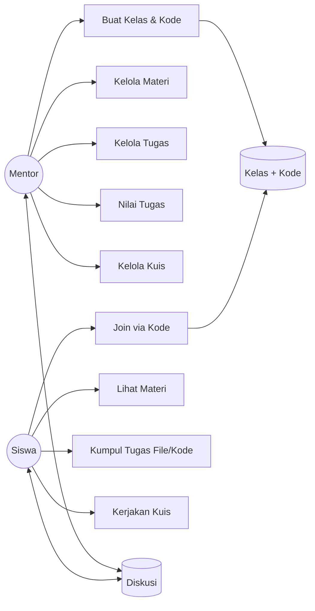

# 02 - Use Case

## Aktor
- Mentor (termasuk Admin kelas)
- Siswa
- Sistem (auto: generate kode, auto-nilai PG, cek deadline)

## Daftar Use Case
```
Mentor:
- UC-M1 Register/Login
- UC-M2 Buat Kelas + Generate Kode
- UC-M3 Kelola Materi (CRUD + upload)
- UC-M4 Kelola Tugas (CRUD)
- UC-M5 Nilai Tugas (lihat file/kode → nilai + feedback)
- UC-M6 Kelola Kuis + Soal
- UC-M7 Lihat Hasil Kuis
- UC-M8 Diskusi (posting/balas/hapus)
- UC-M9 Lihat Dashboard

Siswa:
- UC-S1 Register/Login
- UC-S2 Join Kelas via Kode
- UC-S3 Lihat Materi
- UC-S4 Kumpul Tugas (upload file / submit kode)
- UC-S5 Kerjakan Kuis
- UC-S6 Diskusi
- UC-S7 Lihat Nilai & Feedback
```

## Diagram (Mermaid - bisa paste ke mermaid.live untuk laporan)



## Skenario Kunci

### UC-M2 Buat Kelas
1. Mentor login → Dashboard → "Buat Kelas".
2. Isi nama + deskripsi → Submit.
3. Sistem generate `kode_kelas` unik (6 char, cth `A7X2K9`).
4. Sistem tampilkan kode + tombol copy/share.

### UC-S2 Join Kelas
1. Siswa login → "Gabung Kelas".
2. Input kode → validasi ke server.
3. Jika valid & belum join → masuk anggota. Jika salah → error "Kode tidak ditemukan".
4. Redirect ke halaman detail kelas.

### UC-S4 Kumpul Tugas
1. Siswa buka Tugas → pilih mode: Upload File / Tulis Kode.
2a. Upload: pilih file → validasi ukuran/ekstensi → upload → simpan ke `uploads/tugas/` + insert DB.
2b. Kode: pilih bahasa → paste kode → simpan sebagai file + kolom teks di DB.
3. Sistem tampilkan status "Terkumpul, menunggu nilai".

### UC-M5 Nilai Tugas
1. Mentor buka Tugas → Daftar Pengumpulan.
2. Klik item → download file / lihat kode.
3. Input nilai (0-100) + feedback → Simpan.
4. Siswa langsung bisa lihat nilai (fetch ulang).
```

