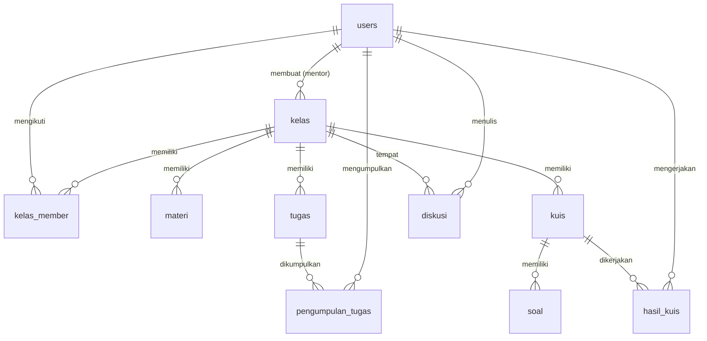

# 03 - ERD dan Skema Database

## ERD (konseptual)

```
users 1───* kelas (mentor_id)
kelas 1───* kelas_member *───1 users (siswa)
kelas 1───* materi
kelas 1───* tugas
tugas 1───* pengumpulan_tugas *───1 users (siswa)
kelas 1───* kuis
kuis 1───* soal
soal 1───* opsi? (disederhanakan: kolom opsi_a..d di tabel soal untuk MVP)
kuis 1───* hasil_kuis *───1 users
kelas 1───* diskusi *───1 users
materi 1───* diskusi (opsional, via materi_id nullable)
```



## Tabel Inti

1. **users**(id, nama, email UNIQUE, password_hash, role ENUM('mentor','siswa'), created_at)
2. **kelas**(id, mentor_id FK, nama_kelas, deskripsi, kode_kelas UNIQUE VARCHAR(10), created_at)
3. **kelas_member**(id, kelas_id FK, siswa_id FK, joined_at, UNIQUE(kelas_id, siswa_id))
4. **materi**(id, kelas_id FK, judul, deskripsi TEXT, file_path NULL, link_video NULL, urutan INT, created_at)
5. **tugas**(id, kelas_id FK, judul, deskripsi TEXT, deadline DATETIME NULL, file_lampiran NULL, created_at)
6. **pengumpulan_tugas**(id, tugas_id FK, siswa_id FK, tipe ENUM('file','code'), file_path NULL, kode_program MEDIUMTEXT NULL, bahasa VARCHAR(20) NULL, nilai INT NULL, feedback TEXT NULL, status ENUM('terkumpul','dinilai') DEFAULT 'terkumpul', submitted_at, graded_at NULL)
7. **kuis**(id, kelas_id FK, judul, deskripsi, durasi_menit INT, deadline DATETIME NULL, created_at)
8. **soal**(id, kuis_id FK, pertanyaan TEXT, opsi_a, opsi_b, opsi_c, opsi_d, kunci CHAR(1))
9. **hasil_kuis**(id, kuis_id FK, siswa_id FK, skor INT, jawaban JSON, submitted_at, UNIQUE(kuis_id, siswa_id))
10. **diskusi**(id, kelas_id FK, materi_id FK NULL, user_id FK, parent_id FK NULL (untuk balasan), isi TEXT, created_at)

Detail kolom + index lihat `database/schema.sql`.

## Catatan Penyimpanan File
- `backend/uploads/materi/<nama-unik>-<file-asli>` — dari mentor.
- `backend/uploads/tugas/<tugasId>-<siswaId>-<timestamp>.<ext>` — dari siswa upload.
- Submit kode: simpan juga sebagai file `.txt` di folder tugas + teks penuh di kolom `kode_program` agar mudah dicari dan dinilai.
- Kolom DB hanya simpan **relative path**, bukan binary.
