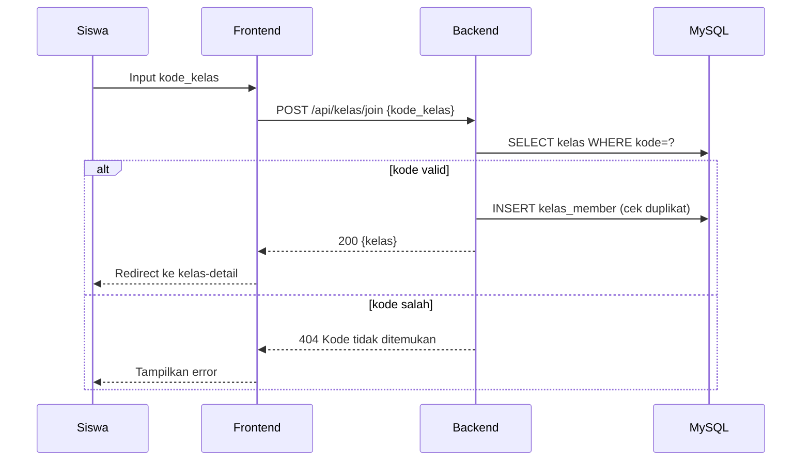
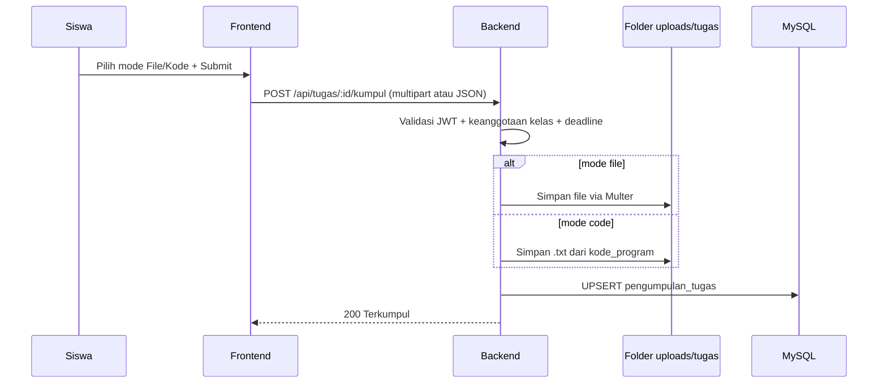

# 04 - Sitemap & Alur Pengguna

## Sitemap Frontend (terkini)

```
/ (index.html: landing Yungkai + portal)
├── pages/
│   ├── auth-login.html (pilih peran) → login-siswa.html (username) / login-mentor.html (email)
│   ├── auth-register.html (nama + username + email + peran)
│   ├── dashboard-mentor.html (statistik + grafik daftar + online + sambutan + feed live)
│   ├── dashboard-siswa.html (sambutan + kontribusi + pengumuman + tugas + nilai)
│   ├── class-mentor.html (CRUD kelas) → kelas-mentor.html?id= (modul/tugas+penilaian/kuis+soal/moderasi/pengumuman/diskusi)
│   ├── class-siswa.html (gabung + daftar) → kelas-siswa.html?id= (Pertemuan 1–14 + diskusi)
│   ├── tugas-saya.html (inbox tugas lintas kelas)
│   ├── transkrip.html (siswa: nilai + unduh txt + kontak) | transkrip-mentor.html (matriks + bulanan)
│   ├── announcement.html (mentor: pengumuman sistem) | pantau.html → pantau-siswa.html (read-only)
│   └── gabung-kelas.html (form kode) [lama, digantikan class-siswa.html]
```
`kelas-detail.html` kini hanya pengalih peran otomatis.

## Flow Join Kelas via Kode


## Flow Kumpul Tugas (File / Kode)


## Flow Nilai Kuis (PG otomatis + esai oleh mentor)
1. Siswa tekan Mulai → server catat `mulai_pada` (timer berjalan).
2. Siswa submit `{soal_id: 'A' | 'teks esai'}` → server tolak bila lewat `durasi_menit`+60 dtk.
3. PG dinilai otomatis; esai menunggu → mentor beri nilai final (`PUT /kuis/hasil/:id/nilai`).
4. Soal diacak (RANDOM) untuk siswa; unduhan file lewat `/api/file?f=...&token=...` (cek hak akses).

## Navigasi Mentor vs Siswa
- Mentor setelah login → `dashboard-mentor.html`: tombol Buat Kelas, daftar kelas, badge "X tugas belum dinilai".
- Siswa setelah login → `dashboard-siswa.html`: tombol Gabung Kelas (input kode), daftar kelas, tugas deadline < 3 hari.
