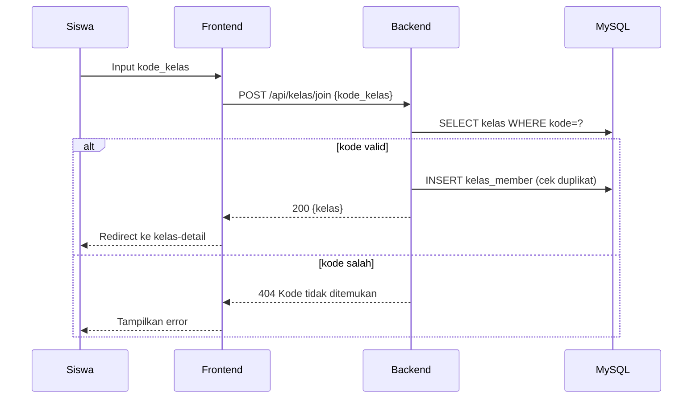
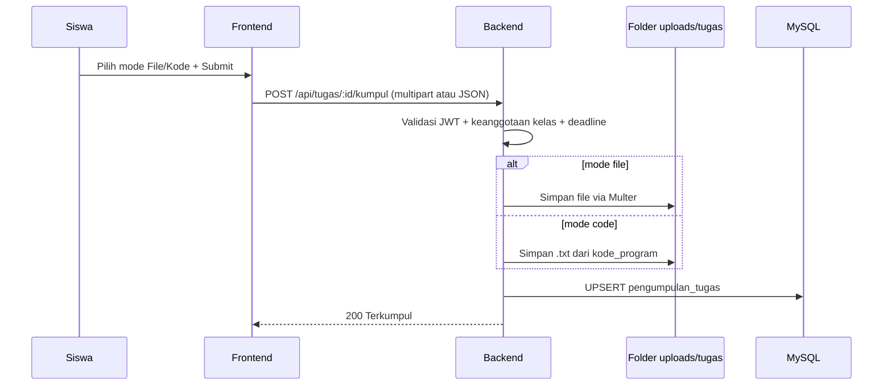

# 04 - Sitemap & Alur Pengguna

## Sitemap Frontend

```
/
├── index.html (landing + login/register)
├── pages/
│   ├── auth-login.html
│   ├── auth-register.html
│   ├── dashboard-mentor.html
│   ├── dashboard-siswa.html
│   ├── kelas-detail.html?id=... (isi: tab Materi | Tugas | Kuis | Diskusi | Anggota)
│   ├── materi-detail.html?id=...
│   ├── tugas-detail.html?id=... (siswa: form upload/kode; mentor: daftar pengumpulan)
│   ├── kuis-detail.html?id=... (kerjakan / kelola soal)
│   └── gabung-kelas.html (form input kode)
```

## Flow Join Kelas via Kode


## Flow Kumpul Tugas (File / Kode)


## Flow Nilai Otomatis Kuis PG
1. Siswa submit jawaban `{soal_id: 'A'}`.
2. Backend ambil kunci dari `soal`, hitung benar/total*100.
3. Simpan ke `hasil_kuis`. Kembalikan skor langsung.

## Navigasi Mentor vs Siswa
- Mentor setelah login → `dashboard-mentor.html`: tombol Buat Kelas, daftar kelas, badge "X tugas belum dinilai".
- Siswa setelah login → `dashboard-siswa.html`: tombol Gabung Kelas (input kode), daftar kelas, tugas deadline < 3 hari.
